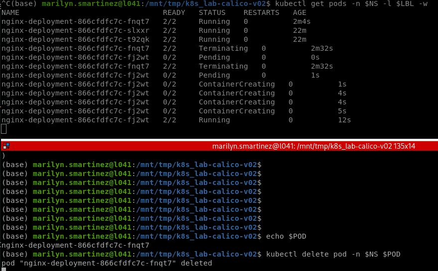
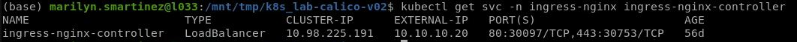
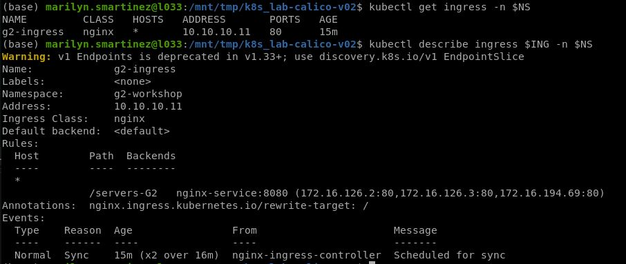
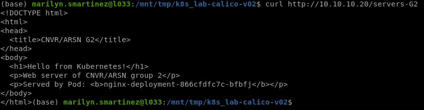
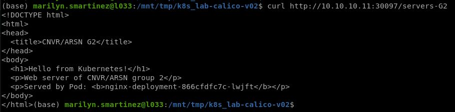
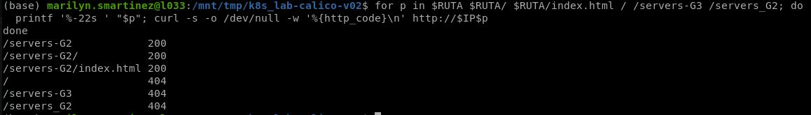

# Fase 1 · Persona B: Aplicación web

Historias: [US-13](../../historias/persona-b.md#us-13), [US-14](../../historias/persona-b.md#us-14) y [US-15](../../historias/persona-b.md#us-15) · Decisiones: [D-002](../../decisions.md), [D-009](../../decisions.md) · Pruebas detalladas: [US-14](../useful/web/pruebas-us14.md), [US-15](../useful/web/pruebas-us15.md)

En esta fase construimos la parte web del escenario: tres servidores Nginx que muestran cada uno el nombre de su Pod, accesibles desde el host a través de un Ingress en la ruta `/servers-G2`. Todo se define en Terraform (`namespace.tf`, `web.tf`, `web-service-deployment.tf` e `ingress.tf`) y se despliega en el namespace dedicado `g2-workshop`.

## Preparación

Antes de escribir código, revisamos el enunciado actualizado y medimos en el escenario los datos que íbamos a necesitar (versiones, IPs de los nodos, NodePorts del Ingress Controller y estado de MetalLB). Los dejamos en [`datos-escenario.md`](../datos-escenario.md).

Creamos el namespace con `kubernetes_namespace_v1` (D-002). Todos los recursos lo referencian con `kubernetes_namespace_v1.namespace.metadata[0].name` en lugar de `var.namespace`. Así Terraform sabe que dependen de él: lo crea primero y lo borra el último.

## US-13 · ConfigMap con la plantilla HTML

Escribimos la plantilla [`templates/index.html.tpl`](../../terraform/templates/index.html.tpl), basada en la de la práctica 1.3, con dos marcadores que se rellenan en momentos distintos:

- `${group}`: lo sustituye Terraform con `templatefile()` durante el `plan`, con el valor de `var.group_number` (2);
- `__POD_NAME__`: lo dejamos sin sintaxis `${}` a propósito, para que Terraform no lo toque y llegue literal al ConfigMap. Lo sustituye cada Pod al arrancar.

Cargamos la plantilla en un `kubernetes_config_map_v1` (`nginx-web-config`) bajo la clave `index.html` y comprobamos con `kubectl get cm -o yaml` que el grupo aparecía ya sustituido y el marcador del Pod seguía intacto.

⟪PENDIENTE: captura de `kubectl get cm nginx-web-config -n g2-workshop -o yaml`⟫

## US-14 · Deployment web con página personalizada

El enunciado ofrece dos formas de generar la página de cada Pod: un contenedor auxiliar (*sidecar*, opción A) o un *initContainer* (opción B). Al principio propusimos la B (D-003), pero finalmente elegimos la **A** (D-009), para aprender el patrón de contenedores que comparten un volumen y conviven durante toda la vida del Pod.

Desplegamos un `kubernetes_deployment_v1` con 3 réplicas de `dgsgiros/nginx-ssh:latest` y la label `app=web`, que comunicamos a la persona C porque la usan el Service y las NetworkPolicies. Cada Pod tiene dos contenedores y dos volúmenes:

- **`page-updater-sidecar`**:
  - recibe su propio nombre en la variable `POD_NAME` mediante la Downward API (`field_ref` a `metadata.name`);
  - ejecuta `sed` sobre la plantilla y escribe el resultado en el `emptyDir`;
  - termina con `sleep infinity`, porque un contenedor normal que acaba se reinicia y el Pod entraría en `CrashLoopBackOff`.
- **`nginx-server`**: sirve el `emptyDir`. No le cambiamos el `command`, porque el entrypoint de la imagen arranca Nginx y también `sshd`.

| Contenedor | Volumen | Ruta | Modo |
|---|---|---|---|
| sidecar | ConfigMap (plantilla) | `/template` | `ro` |
| sidecar | `emptyDir` | `/html` | `rw` |
| nginx | `emptyDir` | `/usr/share/nginx/html` | `ro` |

En el primer despliegue, el `describe` del Pod (captura anterior) mostró que el montaje de Nginx tenía todavía el valor provisional `<nginx root>`. Localizamos la raíz real con `grep -r root /etc/nginx/` dentro del contenedor y corregimos el `mount_path` a `/usr/share/nginx/html`. En la misma captura se ve que el sidecar recibe `POD_NAME` desde `v1:metadata.name` y que la plantilla se monta en solo lectura.

Comprobamos que los 3 Pods quedaban `Running` con `READY 2/2` y sin reinicios, repartidos entre `k8s-worker1` y `k8s-worker2`. En ese momento el Service seguía siendo `NodePort` (80:30001), una versión provisional que cambiamos en US-15.

Por último, borramos uno de los Pods: el Deployment lo sustituyó por otro con un nombre nuevo, que pasó por `Pending` y `ContainerCreating` hasta llegar a `2/2 Running` en unos 12 segundos. Así comprobamos que la página se genera en cada arranque y no se arrastra del Pod anterior.

⟪PENDIENTE: captura de `curl -s localhost` en cada Pod mostrando su propio nombre⟫

## US-15 · Service ClusterIP e Ingress

Cambiamos el Service web a `ClusterIP`, con `port = 8080` (el que usa el Ingress) y `target_port = 80` (donde escucha Nginx), de modo que la única entrada desde fuera del clúster es el Ingress.

Creamos un `kubernetes_ingress_v1` (`g2-ingress`) con:
- clase `nginx` y ruta `/servers-G2` de tipo `Prefix` hacia `nginx-service:8080`;
- la anotación `nginx.ingress.kubernetes.io/rewrite-target: /`. Sin ella, Nginx recibiría `/servers-G2`, que no existe en su raíz, y respondería 404.

Además, añadimos dos fuentes `data` que no crean nada y solo leen, para mostrar en los `outputs` la IP del Ingress Controller y el pool de MetalLB.

Antes de probar, verificamos que MetalLB tenía el pool `default-pool` (`10.10.10.20-10.10.10.30`) y su `L2Advertisement`, y que el Service del Ingress Controller había recibido la IP externa `10.10.10.20`. Su NodePort HTTP era el 30097.

Con `kubectl describe ingress` comprobamos tres cosas:
- el controller había aceptado el Ingress (evento `Sync`);
- la ruta `/servers-G2` apuntaba a los tres endpoints de los Pods en el puerto 80;
- la anotación de reescritura estaba aplicada.

Desde el host accedimos a la página por la IP de MetalLB y por el NodePort del controller. En cada petición respondió un Pod distinto, lo que confirma el balanceo.

Probamos también qué rutas casan con la regla. Las que empiezan por `/servers-G2` devuelven 200 (`Prefix` más la reescritura a `/`). El resto devuelve 404, y ese 404 lo genera el backend por defecto del controller, no nuestros Pods.

Por último, borramos un Pod mientras observábamos el EndpointSlice del Service. La IP del Pod borrado (`172.16.126.3`) desapareció y entró la del nuevo (`172.16.194.72`), sin tocar el Service ni el Ingress. El Service selecciona los Pods por label, no por nombre ni por IP.

