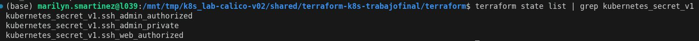
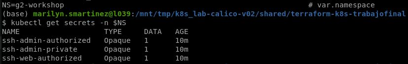

# Fase 1 · Persona C: Seguridad

Historias: [US-16](../../historias/persona-c.md#us-16), [US-17](../../historias/persona-c.md#us-17) · Decisiones: [D-004](../../decisions.md) · Guía y pruebas detalladas: [ssh-keys.md](../ssh-keys.md)

En esta fase preparamos las claves SSH del escenario y las cargamos en Kubernetes como Secrets gestionados por Terraform. Las claves se generan en el host con un script del repositorio (`scripts/gen-keys.sh`) y los Secrets se definen en `terraform/ssh.tf`, en el namespace `g2-workshop`. Después las montamos en el Pod admin y en los Pods web (US-17); el acceso por el `NodePort` y por la VLAN queda para US-18 y US-24.

## US-16 · Claves SSH y Secrets

### Diseño: dos pares independientes

Siguiendo el enunciado (§2.5), usamos **dos pares de claves**, uno por cada relación de confianza (D-004):

| Par | Ficheros | Dirección | Privada | Pública |
|---|---|---|---|---|
| 1 | `par1_admin`, `par1_admin.pub` | admin → web y LXC | Secret `ssh-admin-private` (Pod admin) | Secret `ssh-web-authorized` (Pods web) y `filetree` de los LXC `bbdd` y `logs` |
| 2 | `par2_host`, `par2_host.pub` | host → admin | se queda en el host | Secret `ssh-admin-authorized` (Pod admin) |

La privada del par 1 vive dentro del clúster (en un Secret y en el Pod admin). Si se filtrara, daría acceso a los web y a los LXC, pero no al propio admin, porque para entrar en él hace falta la privada del par 2, que nunca sale del host.

Elegimos claves **ed25519**: ocupan una sola línea corta y son el tipo recomendado actualmente por OpenSSH.

### Generación de las claves

El entorno del laboratorio se crea de cero cada día y solo el repositorio persiste, así que las claves no pueden guardarse: se **regeneran cada día** con `scripts/gen-keys.sh`, que se ejecuta en el host, sin `sudo`, después de clonar el repositorio y antes de crear los LXC y de hacer `terraform apply`. El script:

- es no interactivo: borra las claves del día anterior (`ssh-keygen` pregunta antes de sobrescribir) y genera las nuevas sin passphrase (`-N ""`), porque el Pod admin tiene que poder usarlas sin que nadie la teclee;
- añade a cada clave un comentario con el par y la fecha (`-C par1_admin-2026-11-17`), para saber de un vistazo qué clave hay en un `authorized_keys`;
- crea `keys/` con permisos `700` y copia la pública del par 1 a `vnx/filetree/ssh/authorized_keys`, desde donde el `<filetree>` de VNX la instalará en los LXC al arrancar;
- usa `set -euo pipefail`, para que un fallo detenga el script y no queden claves a medias.

Lo ejecutamos sin `sudo` para que las claves sean del usuario del host: si fueran de `root`, no podríamos usar `keys/par2_host` con `ssh -i`. La VM `terraform` las lee igualmente a través de la carpeta compartida `/shared`.

Como el script se ejecuta justo después de cada `git clone`, añadimos `chmod +x` antes de llamarlo en los pasos de arranque ([datos-escenario.md](../datos-escenario.md) §1 y `scripts/host-script.sh`).


En la captura se ven los cuatro ficheros: las privadas con `600` (`ssh` se niega a usar una privada propia que otros puedan leer) y las públicas con `644`.

Ni las claves ni su copia para los LXC se suben a Git. `keys/` ya estaba en `.gitignore`, y añadimos `vnx/filetree/ssh/`: la clave pública no es secreta, pero cambia cada día y aparecería en cada commit.

⟪PENDIENTE: captura de `git check-ignore -v keys/par1_admin vnx/filetree/ssh/authorized_keys` y `git status` sin claves⟫

### Secrets en Terraform

En `terraform/ssh.tf` creamos tres `kubernetes_secret_v1`, que leen las claves con `file()` en lugar de crearlas con `kubectl create secret`, como pide el enunciado:

| Recurso | Secret | Clave en `data` | Fichero |
|---|---|---|---|
| `ssh_admin_private` | `ssh-admin-private` | `id_ed25519` | `keys/par1_admin` |
| `ssh_admin_authorized` | `ssh-admin-authorized` | `authorized_keys` | `keys/par2_host.pub` |
| `ssh_web_authorized` | `ssh-web-authorized` | `authorized_keys` | `keys/par1_admin.pub` |

Algunos detalles de la implementación:

- **Nombre de la clave en `data`.** Cuando un Secret se monta como volumen, cada clave de `data` se convierte en un fichero. Por eso las llamamos `id_ed25519` y `authorized_keys`, los nombres que esperan `ssh` y `sshd`.
- **Sin `base64encode()`.** En `data` el provider ya codifica el contenido en base64; si lo hiciéramos también nosotros, quedaría codificado dos veces.
- **Ruta de las claves.** `file()` resuelve las rutas relativas desde el directorio donde se ejecuta `terraform`, no desde el `.tf`. Añadimos la variable `ssh_keys_dir = "../keys"` y la usamos como `"${path.module}/${var.ssh_keys_dir}"`, porque el valor por defecto de una variable no puede contener `path.module`.
- **Namespace.** Los Secrets referencian `kubernetes_namespace_v1.namespace.metadata[0].name` en lugar de `var.namespace`, para que Terraform cree el namespace antes que ellos.
- **Un Secret para los 3 web.** Los tres Pods aceptan la misma clave, así que comparten un único Secret. El admin, en cambio, tiene dos (privada y `authorized_keys`), como recomienda el enunciado, para poder montar cada uno con sus permisos.
- **Si falta `keys/`**, `terraform plan` falla con `no file exists`. Así, si se olvida ejecutar `gen-keys.sh`, Terraform no crea Secrets vacíos.

Añadimos también el output `ssh_secret_names` con los nombres de los tres Secrets, para consultarlos desde fuera de Terraform (por ejemplo, en `verify.sh`).

Tras el `apply`, los tres Secrets aparecen en el estado de Terraform:



Y en el clúster, de tipo `Opaque` y con una entrada de datos cada uno:



⟪PENDIENTE: captura de la prueba P9 de [ssh-keys.md](../ssh-keys.md) §7 (el contenido decodificado de cada Secret coincide con su fichero de `keys/`)⟫

### Seguridad: las claves en el estado de Terraform

Aunque las claves se generan fuera de Terraform, al leerlas con `file()` su contenido queda guardado en el `terraform.tfstate`, y en claro: base64 no es cifrado. Por eso el estado nunca se sube a Git (`*.tfstate*` está en `.gitignore`). En un entorno real habría que guardar el estado en un backend cifrado y con acceso restringido.

⟪PENDIENTE: captura de `grep -c "BEGIN OPENSSH" terraform.tfstate` en la VM⟫

### Coordinación con el equipo

- **Persona A** (US-20, US-21): la pública del par 1 queda en `vnx/filetree/ssh/authorized_keys` para el `<filetree>` de los LXC. Usamos una subcarpeta propia (`ssh/`) para que, si el `filetree` incluye otras configuraciones (MariaDB, rsyslog), estas no acaben en `.ssh/`. Falta confirmar con A el usuario de destino en los LXC.
- **US-17**: montamos `ssh-admin-private` y `ssh-admin-authorized` en el Pod admin (con `fsGroup: 1000` y modo `0440`) y `ssh-web-authorized` en los Pods web, en un PR que revisó la persona B.

## US-17 · Pod de administración

Evidencias: [`docs/capturas/us-17-*.txt`](../capturas/) · PR #4 (rama `us-17-admin`)

### Antes de escribir el Pod: revisamos las imágenes

Antes de montar nada, entramos en las imágenes `dgsgiros/admin-ssh` y `dgsgiros/nginx-ssh` para ver cómo vienen preparadas ([us-17-imagenes.txt](../capturas/us-17-imagenes.txt)):

- `adminuser` y `webuser` tienen UID y GID 1000, y cada imagen ya trae un `~/.ssh` con permisos `700` y dueño el usuario;
- `sshd` arranca solo, con `PubkeyAuthentication yes`, `PasswordAuthentication no` y `PermitRootLogin no`, así que el único acceso posible es con clave;
- el admin lleva OpenSSH 8.9 (Ubuntu) y los web OpenSSH 10.0 (Debian). Los dos aceptan claves ed25519, con lo que confirmamos la elección de D-004.

### El Pod admin

En `terraform/admin-service-deployment.tf` desplegamos el admin como un Deployment de una réplica (`var.admin_num_replicas`), para que Kubernetes lo vuelva a crear si se cae. Sobre el borrador que ya teníamos:

- **`nodeSelector`** `kubernetes.io/hostname = k8s-worker1`, como pide el enunciado. Así sabemos siempre en qué nodo está, algo que necesitamos en US-18 para el SSH por `NodePort` con `externalTrafficPolicy: Local`.
- **`container_port = 22`**, el puerto de `sshd` (el borrador tenía el 80).
- **`fsGroup: 1000`** en el `security_context` del Pod: Kubernetes crea los ficheros de los Secrets como `root`, pero con este campo les pone el grupo 1000, el de `adminuser`.
- **La privada con modo `0440`, no `0600`.** Como el fichero es de `root`, con `0600` `adminuser` no podría leerlo. Con `0440` lo lee por grupo, y `ssh` no se queja de los permisos porque el fichero no es suyo.
- **Un montaje por fichero, con `sub_path`.** Dos Secrets montados como volumen en el mismo directorio no pueden convivir (el segundo tapa al primero). Montamos cada clave como un fichero suelto (`~/.ssh/id_ed25519` y `~/.ssh/authorized_keys`), y así además conservamos el `~/.ssh` de la imagen con su dueño y sus permisos.

Llamamos a la privada `id_ed25519`, el nombre que `ssh` busca por defecto para este tipo de clave, y corregimos la historia y la guía, que todavía decían `id_rsa`.

Con esto, dentro del Pod, `adminuser` ve sus claves así ([us-17-claves-permisos.txt](../capturas/us-17-claves-permisos.txt)):

```
drwx------ 1 adminuser adminuser 4096 Nov 18 06:41 .
-r--r--r-- 1 root      adminuser  102 Nov 18 06:41 authorized_keys
-r--r----- 1 root      adminuser  411 Nov 18 06:41 id_ed25519
```

Temíamos que `sshd` rechazara el `authorized_keys` por `StrictModes`, pero no hizo falta el plan B del initContainer: `StrictModes` acepta ficheros cuyo dueño sea `root` o el propio usuario, siempre que nadie más pueda escribir en ellos, y aquí son de solo lectura.

### La clave en los Pods web

En los Pods web montamos el Secret `ssh-web-authorized` (la pública del par 1) en `/home/webuser/.ssh/authorized_keys`, también con `sub_path`. Un solo Secret sirve para las tres réplicas. Como este cambio toca `web-service-deployment.tf`, que es de la persona B, lo hicimos en un PR que revisó B.

### Pruebas

Todavía sin el Service de US-18, probamos el acceso desde el host con un `kubectl port-forward` al puerto 22 del Pod ([us-17-pruebas.txt](../capturas/us-17-pruebas.txt)):

| Prueba | Resultado |
|---|---|
| El Pod admin corre en `k8s-worker1` | `Running`, `NODE k8s-worker1` |
| `adminuser` lee su privada (`cat ~/.ssh/id_ed25519`) | ✅ |
| `sshd` activo en el admin | ✅ proceso 1, `sshd -D -e` |
| SSH admin → web como `webuser`, con el par 1 | ✅ responde con el nombre del Pod web |
| SSH host → admin con `keys/par2_host` | ✅ entra como `adminuser` |
| SSH host → admin con la clave del par 1 (prueba negativa) | ❌ `Permission denied (publickey)`, como esperábamos |

La prueba negativa confirma la separación de D-004: la privada del par 1 abre los web, pero no el propio admin.

El SSH al admin por su `NodePort` (`10.10.10.11:<nodePort>`) y por la VLAN quedan para US-18 y US-24.
