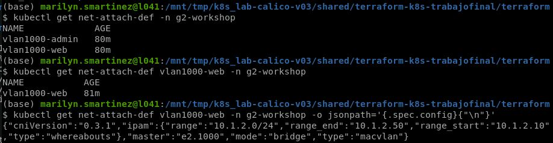
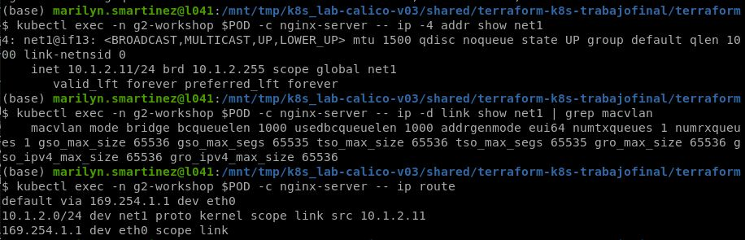
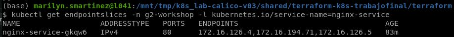
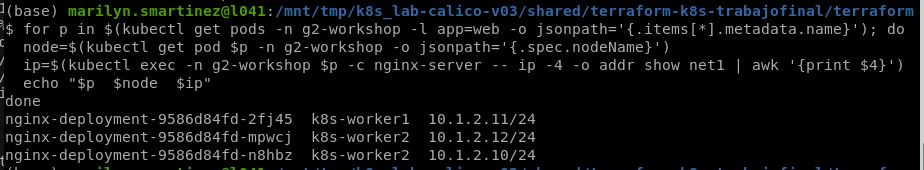
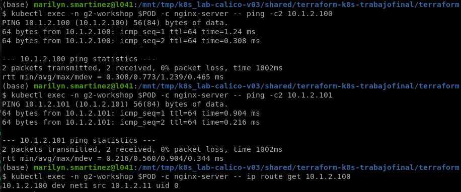
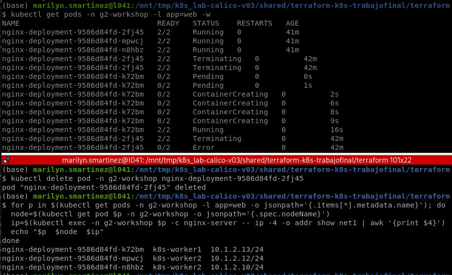

# Fase 2 · Persona B: Aplicación web en la VLAN

Historias: [US-22](../../historias/persona-b.md#us-22) · Decisiones: [D-005](../../decisions.md) (IPAM de la VLAN), [D-010](../../decisions.md) (una sola VLAN) · Pruebas detalladas: [US-22](../useful/web/pruebas-us22.md) · Salida completa: [`us-22-output.txt`](../useful/web/us-22-output.txt)

En esta fase conectamos los servidores web a la VLAN compartida con el Pod admin y los LXC `bbdd` y `logs`. Cada Pod web conserva su interfaz de Calico (`eth0`), que usan el Service y el Ingress, y recibe una segunda interfaz `net1` en la VLAN 1000 (`10.1.2.0/24`) a través de Multus.

## US-22 · Interfaz Multus en los Pods web

### Qué cambiamos

La red de la VLAN ya estaba definida por la persona A en US-11: la `NetworkAttachmentDefinition` `vlan1000-web`, de tipo `macvlan` en modo `bridge` sobre la subinterfaz `e2.1000` de los workers, con IPAM `whereabouts` en el rango `10.1.2.10`–`10.1.2.50` (D-005). Nuestro trabajo fue pedir esa red desde los Pods web, añadiendo una anotación al Deployment en [`web-service-deployment.tf`](../../terraform/web-service-deployment.tf):

```hcl
template {
  metadata {
    labels = local.web_labels
    annotations = {
      "k8s.v1.cni.cncf.io/networks" = kubernetes_manifest.nad_web.manifest.metadata.name
    }
  }
```

Dos detalles de esta anotación:

- **Va en `template.metadata`, no en el `metadata` del Deployment.** Multus lo llama el kubelet al crear cada Pod, y lee las anotaciones del Pod. Las del objeto Deployment no se copian a sus Pods.
- **Referencia el recurso de la NAD** en lugar de escribir `"vlan1000-web"`. Así el nombre sigue a `var.vlan_id`, y Terraform sabe que el Deployment depende de la NAD: la crea antes y la destruye después.

Añadimos también el output `web_multus_networks` en [`outputs.tf`](../../terraform/outputs.tf), que muestra la red que piden los Pods web.

El `terraform apply` cambió solo el Deployment. Al modificarse el template, Kubernetes hizo un *rolling update* y sustituyó los 3 Pods por otros nuevos, porque las interfaces solo se crean cuando arranca un Pod.

### Pruebas

Seguimos la guía [`pruebas-us22.md`](../useful/web/pruebas-us22.md), de dentro hacia fuera.

**La NAD existe** en el namespace `g2-workshop`, con la configuración esperada: `macvlan`, `bridge`, `e2.1000` y `whereabouts`.



**Cada Pod tiene `net1`.** El campo `network-status`, que escribe Multus, muestra dos interfaces: `eth0` con la IP de Calico (`172.16.194.71`, la interfaz por defecto) y `net1` en `g2-workshop/vlan1000-web` con `10.1.2.11`. Dentro del Pod, `net1` es de tipo `macvlan mode bridge`, y la tabla de rutas reparte el tráfico: `10.1.2.0/24` sale por `net1` y todo lo demás por `eth0`, hacia la puerta de enlace de Calico (`169.254.1.1`).



**Kubernetes sigue usando `eth0`.** Los endpoints del Service web siguen siendo las 3 IPs de Calico, no las de la VLAN: Services, Ingress y NetworkPolicies solo conocen la interfaz principal. Comprobamos también que el Ingress seguía repartiendo las peticiones a partes iguales entre los 3 Pods nuevos (4 de 12 cada uno).



**Las 3 IPs de `net1` son distintas**, aunque dos Pods estén en `k8s-worker2` y otro en `k8s-worker1`: `10.1.2.10`, `.11` y `.12`. Este era el criterio principal. Con `host-local` cada worker lleva su propio contador y se repetían IPs (US-19); con `whereabouts` las reservas se guardan en un `IPPool` del clúster (`kube-system/10.1.2.0-24`), que tenía exactamente 3 `podref`, uno por Pod.



**Conectividad por la VLAN.** Desde un Pod web hay ping a `bbdd` (`10.1.2.100`) y a `logs` (`10.1.2.101`), y `ip route get` confirma que sale por `net1`. También funcionaron el ping desde `bbdd` hacia un Pod web y el ping entre Pods web de workers distintos (`10.1.2.11` → `10.1.2.12`), que cruza `VlanNet` sin pasar por Calico.



**Un Pod nuevo recibe IP.** Borramos un Pod y el Deployment creó otro (`k72bm`), que llegó a `2/2 Running` en 16 segundos con una IP nueva de `net1` (`10.1.2.13`), sin repetir ninguna de las otras dos.



### Pendiente

El criterio pide también ping al Pod admin (`10.1.2.5`), que hoy da `100% packet loss`: el admin aún no tiene la anotación de `vlan1000-admin`. Es parte de [US-24](../../historias/persona-c.md#us-24) (persona C), y lo probaremos juntos cuando esté.

En la última captura se ve que el Pod borrado pasó por `Error` antes de desaparecer. Parece que el sidecar (`sleep infinity`) no atiende la señal de parada, así que Kubernetes lo mata al acabar el periodo de gracia. No afecta al servicio, pero lo revisaremos.
