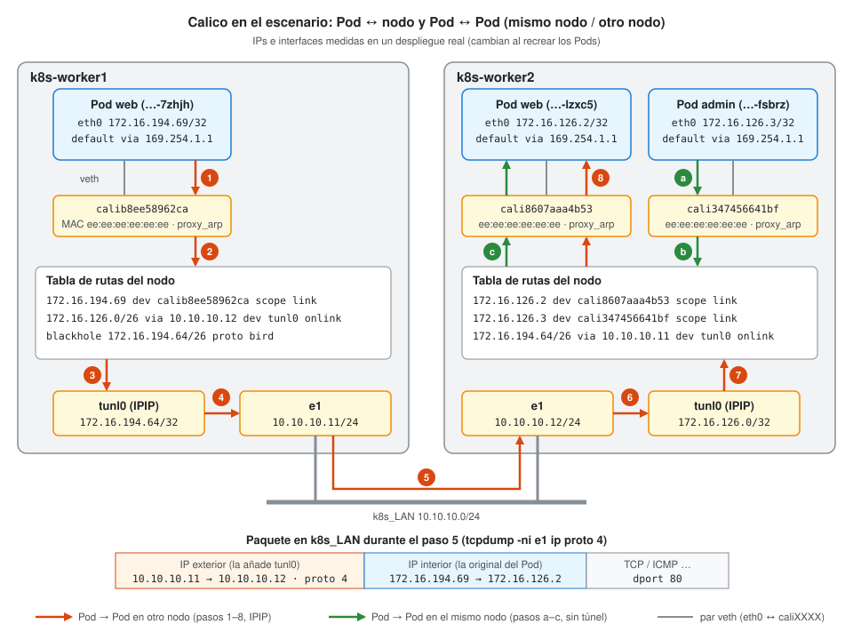

# 🧭 Guía: Calico (y en qué se diferencia de Flannel)

⬅️ [Volver al plan](../../../plan.md) · Relacionado: [datos del escenario §3](../../datos-escenario.md#3-kubernetes) · [guía de Multus](../multus/guia-multus.md) · [US-30](../../../historias/persona-c.md#us-30)

---

## 1. Qué es Calico

Calico es el **CNI** del clúster: el plugin que da una IP a cada Pod y hace que los Pods de nodos distintos se alcancen entre sí. Además **aplica las NetworkPolicies**, algo que Flannel (el CNI de la práctica 1.3) no hace.

A diferencia de Flannel, Calico **enruta** en lugar de usar un bridge:
- Cada Pod tiene una veth (`caliXXXX`), y el nodo tiene una **ruta /32 por Pod**.
- Los nodos se pasan las rutas de sus Pods por **BGP** (el demonio BIRD dentro del Pod `calico-node`).
- Las NetworkPolicies las aplica **Felix** (también en `calico-node`) con reglas iptables en cada nodo.

En nuestro escenario: pool `172.16.0.0/16`, encapsulado **IPIP** (`ipipMode: Always`) y nodos detectados por la interfaz `e1`.

---

## 2. Flannel vs Calico

| | Flannel (P1.3) | Calico (Trabajo Final) |
|---|---|---|
| **IPs de los Pods** | Una /24 por nodo, sacada del CIDR de Pods | Pool `172.16.0.0/16`, repartido en **bloques** (normalmente /26) que se asignan a los nodos según hagan falta |
| **Dentro del nodo** | Los Pods cuelgan de un **bridge** (`cni0`), que hace de gateway | **Sin bridge.** Cada Pod tiene una veth (`caliXXXX`) y el nodo una **ruta /32 por Pod** |
| **Gateway del Pod** | La IP de `cni0` (p. ej. `10.244.1.1`) | `169.254.1.1`, una dirección ficticia a la que el nodo responde por **proxy-ARP** |
| **Entre nodos** | Overlay, normalmente **VXLAN** (`flannel.1`) | Rutas aprendidas por **BGP**; aquí encapsuladas en **IPIP** (`tunl0`) |
| **Cómo se aprenden las rutas** | flanneld lee las subredes de la API de k8s / etcd | Los nodos se intercambian rutas por BGP: es enrutamiento real |
| **NetworkPolicy** | ❌ Se aceptan pero nadie las aplica | ✅ Felix escribe las reglas (iptables o eBPF) en cada nodo |

---

## 3. Cómo viaja un paquete en el escenario



Las IPs, interfaces y rutas del diagrama son reales, medidas en un despliegue (🔁 cambian al recrear los Pods). Los nombres son los de los Pods del borrador de `terraform/`: tres web y un admin.

### 3.1 Pod ↔ su nodo: la puerta de enlace `169.254.1.1`

**Ninguna interfaz tiene la IP `169.254.1.1`**, ni en el Pod ni en el nodo. Hay dos piezas, y cada una la pone un componente distinto de Calico:

1. **Dentro del Pod, el plugin CNI de Calico** (`/opt/cni/bin/calico`) escribe las rutas al crear el Pod:
   ```
   169.254.1.1 dev eth0 scope link      ← "esta dirección está directamente en eth0"
   default via 169.254.1.1 dev eth0     ← "todo lo demás, a ella"
   ```
   `eth0` solo tiene una `/32` (p. ej. `172.16.194.69/32`). Con una /32 no hay subred, así que el kernel no aceptaría ninguna puerta de enlace sin la primera ruta, `scope link`. `169.254.0.0/16` es el rango *link-local*, que no puede chocar con ninguna IP real.

2. **En el nodo, Felix** (dentro de `calico-node`) activa `proxy_arp` en cada `caliXXXX`. El extremo del veth en el nodo siempre tiene la MAC `ee:ee:ee:ee:ee:ee`. Cuando el Pod pregunta por ARP "¿quién tiene 169.254.1.1?", el nodo contesta con esa MAC. Esto se ve en el Pod con `ip neigh`:
   ```
   169.254.1.1 dev eth0 lladdr ee:ee:ee:ee:ee:ee
   ```

A partir de ahí, **cada trama que sale del Pod va al nodo**, sea cual sea el destino. El nodo la recibe por `caliXXXX` y la **enruta** con su propia tabla de rutas (`ip_forward = 1`). En el sentido contrario, nodo → Pod (p. ej. las sondas del kubelet), el nodo usa la ruta /32 `172.16.194.69 dev calib8ee58962ca scope link` y el Pod responde a la ARP con su propia MAC.

¿Por qué así? La puerta de enlace es **la misma en todos los Pods de todos los nodos** y no depende de ninguna IP del nodo. No hace falta un bridge ni una IP de gateway por nodo, como el `cni0` de Flannel. Todo el tráfico de los Pods se **enruta en L3**, nunca se conmuta en L2, y por eso Felix puede aplicar las NetworkPolicies en un único punto: la interfaz `caliXXXX` de cada Pod.

### 3.2 Pod → Pod en el mismo nodo (pasos a–c, en verde)

Ejemplo: el admin `172.16.126.3` hace un `curl` al web `172.16.126.2`. Los dos están en k8s-worker2.

- **a.** El admin no tiene ninguna ruta específica hacia `172.16.126.2`, así que usa `default via 169.254.1.1`. La trama sale por su `eth0` con MAC destino `ee:ee:ee:ee:ee:ee` y llega al nodo por `cali347456641bf`.
- **b.** El nodo busca el destino en su tabla y encuentra la /32 `172.16.126.2 dev cali8607aaa4b53`. Aquí Felix aplica las reglas iptables: la política de **egress** del admin y la de **ingress** del web.
- **c.** El nodo resuelve por ARP la MAC del web en `cali8607aaa4b53` y entrega el paquete.

Aunque los dos Pods estén en el mismo nodo, **hay un salto de router** (el nodo): un `ping` del admin al web llega con `ttl=63`, no 64. No hay túnel ni NAT, y la IP de origen llega intacta.

### 3.3 Pod → Pod en otro nodo (pasos 1–8, en naranja)

Ejemplo: el web `172.16.194.69` (k8s-worker1) hace un `curl` al web `172.16.126.2` (k8s-worker2).

1. Igual que antes: `default via 169.254.1.1` → la trama llega a k8s-worker1 por `calib8ee58962ca`. Felix aplica el **egress** del Pod de origen.
2. En la tabla de worker1 no hay ninguna /32 para `172.16.126.2`, pero sí el **bloque /26 del otro nodo**, aprendido por BGP (`proto bird`):
   `172.16.126.0/26 via 10.10.10.12 dev tunl0 onlink`.
   `onlink` le dice al kernel que trate `10.10.10.12` como directamente alcanzable por `tunl0`, aunque `tunl0` no tenga ninguna subred.
3. El paquete entra en `tunl0`, el túnel **IPIP** (`ipipMode: Always`).
4. `tunl0` lo **encapsula**: le pone delante una cabecera IP exterior `10.10.10.11 → 10.10.10.12` con protocolo **4** (IP-in-IP). Ese paquete exterior se enruta como cualquier otro tráfico del nodo: `10.10.10.0/24 dev e1`.
5. Por `k8s_LAN` viaja el paquete encapsulado (recuadro del diagrama). El switch y `r1` solo ven IPs de nodos, nunca IPs de Pods.
6. k8s-worker2 recibe por `e1` un paquete de protocolo 4 dirigido a él, y el kernel se lo pasa a su `tunl0`.
7. `tunl0` **desencapsula**: quita la cabecera exterior y queda el paquete original `172.16.194.69 → 172.16.126.2`, que se enruta con la tabla de worker2.
8. La /32 `172.16.126.2 dev cali8607aaa4b53` lo entrega al Pod. Felix aplica el **ingress** del Pod destino.

La respuesta hace el camino inverso con la ruta `172.16.194.64/26 via 10.10.10.11 dev tunl0` de worker2. Hay dos saltos de router (`ttl=62`) y **ningún NAT**: el Pod destino ve la IP real del Pod de origen.

Detalles que se ven en la tabla de rutas:
- **`blackhole 172.16.194.64/26`**: es el bloque **propio** del nodo. Si llega un paquete para una IP de ese bloque que no tiene /32 (un Pod que ya no existe), se descarta aquí en lugar de salir por la ruta por defecto. Las /32 de los Pods vivos son más específicas y ganan siempre.
- **`tunl0` tiene una IP** (`172.16.194.64/32`, la primera del bloque). La usa el nodo como origen cuando él mismo habla con Pods de otros nodos.
- **MTU 1440** en el `eth0` de los Pods y en `tunl0` (frente a 1500 en `e1`): deja sitio para la cabecera IPIP sin fragmentar.

### 3.4 Comandos para verlo

En un worker (`ssh root@k8s-worker1`):
```bash
ip route                 # 172.16.x.x/26 via <otro nodo> dev tunl0 proto bird   ← bloque del otro nodo, por IPIP
                         # 172.16.x.y dev caliXXXX scope link                     ← una ruta por Pod local
ip -d link show tunl0    # el túnel IPIP
ip link | grep cali      # una veth por Pod de este nodo
tcpdump -ni e1 ip proto 4   # paquetes IPIP entre nodos (cabecera exterior nodo→nodo, Pod→Pod dentro)
ip route get 172.16.126.2   # qué ruta elige el nodo para un destino concreto (§3.3, paso 2)
ip route | grep <ip-pod>    # → caliXXXX del Pod
cat /proc/sys/net/ipv4/conf/caliXXXX/proxy_arp   # 1: el nodo responde a la ARP de 169.254.1.1
tcpdump -eni caliXXXX arp   # ARP del Pod y respuesta con ee:ee:ee:ee:ee:ee (el Pod no puede vaciar su caché ARP, le falta NET_ADMIN: dejar el tcpdump abierto y hacer ping desde el Pod tras un par de minutos sin tráfico)
```

Dentro de un Pod (`kubectl exec -it <pod> -- sh`):
```bash
ip addr                  # eth0 con una /32: el Pod no tiene "subred"
ip route                 # default via 169.254.1.1 dev eth0
ip neigh                 # 169.254.1.1 → ee:ee:ee:ee:ee:ee (proxy-ARP del lado del nodo)
ping -c1 <ip-pod-mismo-nodo>   # ttl=63: un salto (el nodo)
ping -c1 <ip-pod-otro-nodo>    # ttl=62: dos saltos (nodo origen y nodo destino)
cat /sys/class/net/eth0/mtu    # 1440: hueco para la cabecera IPIP
```

Desde el host:
```bash
kubectl get ippools.crd.projectcalico.org -o yaml      # CIDR, ipipMode, natOutgoing
kubectl get blockaffinities.crd.projectcalico.org      # qué bloque /26 tiene cada nodo
```

---

## 4. ⚠️ Trampas a tener en cuenta

- **Calico solo controla las interfaces que crea él.** La interfaz extra de Multus (`net1`, la VLAN) queda **fuera** de Calico: las NetworkPolicies no se aplican al tráfico de la VLAN.
- **Default-deny de egress corta el DNS.** Con la política de denegación por defecto, los Pods no resuelven nombres hasta que se permite egress a `kube-dns` en 53/UDP y 53/TCP.
- **NetworkPolicy no filtra ICMP.** No se puede escribir una regla "solo ping". Una regla **sin `ports`** permite todos los protocolos, ICMP incluido.
- **El puerto de la política es el del Pod**, no el del Service: para los web es el 80, no el 8080. La política se evalúa después del DNAT del Service.
- **`namespaceSelector` + `podSelector`** en el **mismo** elemento de `from` es un AND; en elementos separados es un OR (y abre mucho más de lo que se quiere).
- **La IP de origen se pierde con un NodePort normal.** Si el nodo reenvía el tráfico a otro nodo, hace SNAT y la política del admin (`ipBlock 10.10.20.2/32`) lo bloquea. Por eso el Service del admin usa `externalTrafficPolicy: Local` y hay que conectar a `10.10.10.11` (el nodo donde está el Pod).
- **El tráfico IPIP (protocolo 4) tiene que poder pasar entre los nodos.** Si un ping entre Pods de nodos distintos falla pero dentro del mismo nodo funciona, mirar `tunl0` y las rutas `proto bird`.
- **Las IPs de los Pods cambian** al recrearlos. Nunca usar IPs de Pods en Terraform ni en las políticas: usar labels y Services.
